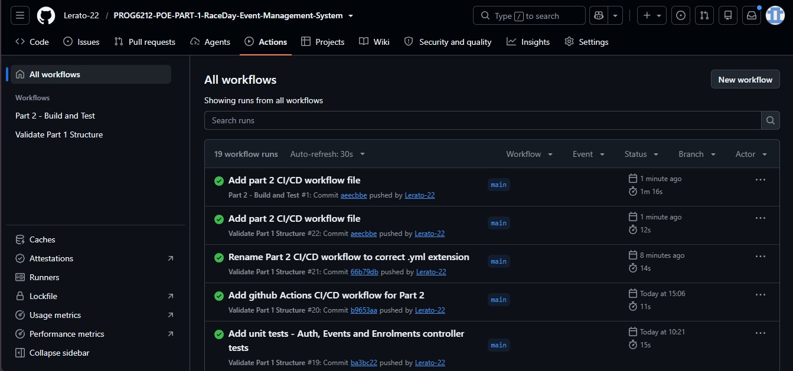

# PROG6212-POE-PART-1-RaceDay-Event-Management-System
# RaceDay - Event Management System

**Module:** PROG6212 - Programming 2B  
**Student:** Lerato Maropola 
**Student Number:** ST10449273
**Part:** 1 - System Planning and Database  
**Total Marks:** 100
**GitHub:** [PROG6212-POE-PART-1-RaceDay-Event-Management-System](https://github.com/Lerato-22/PROG6212-POE-PART-1-RaceDay-Event-Management-System)

## System Description

RaceDay is a full-stack web-based event management system built for the South African road running, walking, and cycling community. The platform allows Organisers to create and manage events, categories, and participant results, while Participants can browse upcoming events, enrol, track their personal performance history, and prepare for race day.

This is Part 1 of the Portfolio of Evidence which covers the full system planning phase — including the Entity Relationship Diagram, the API Endpoint Plan, and the SQL Database Script. No application code is written in this part.

## User Roles

- **Organiser** — can create, edit, and delete events, manage event categories, capture participant results, and view all event enrolments.
- **Participant** — can create an account, browse events, enter an event by selecting a category, view their own enrolments, and track their personal results.

## Part 1 Planning Documents

All planning documents are located in the `/docs` folder:

| File | Description |
|---|---|
| `ERD.drawio.png` | Entity Relationship Diagram showing all 6 entities, attributes, primary keys, foreign keys, and cardinality |
| `RaceDay-API-EndPoint-Plan..pdf` | Full API Endpoint Plan covering all 6 resource groups with HTTP method, route, role, request body, and response codes |
| `raceday_database.sql` | SQL Database Script that creates the full schema and seeds realistic sample data |


## How To Run The SQL Script

1. Open **SQL Server Management Studio (SSMS)**
2. Open the file `docs/raceday_database.sql`
3. Highlight the `CREATE DATABASE RaceDay;` line and press **F5**
4. Highlight the `USE RaceDay;` line and press **F5**
5. Select everything from the `DROP TABLE` lines to the bottom and press **F5**
6. Verify the output — you should see **Commands completed successfully** and a total count table showing all 6 tables with data

## CI/CD Screenshot

The GitHub Actions workflow validates that the `/docs` folder exists and contains all required planning files on every push to main.


## Video Presentation

[Part 1 Video Walkthrough - YouTube]
https://youtu.be/xVeU20NCDJQ?si=_gRC87FSh1AQPpWY


## Part 2 - RESTful API Development

**Module:** PROG6212 - Programming 2B
**Student:** Lerato Maropola
**Student Number:** ST10449273
**Part:** 2 - RESTful API Development
**Total Marks:** 100
**GitHub:** [PROG6212-POE-PART-1-RaceDay-Event-Management-System](https://github.com/Lerato-22/PROG6212-POE-PART-1-RaceDay-Event-Management-System)

## System Description

RaceDay is a full-stack web-based event management system built for the South African road running, walking, and cycling community. The platform allows Organisers to create and manage events, categories, and participant results, while Participants can browse upcoming events, enrol, track their personal performance history, and prepare for race day.

This is Part 2 of the Portfolio of Evidence which covers the RESTful API development phase — including authentication, role-based access control, all CRUD endpoints, Swagger integration, unit testing, and GitHub Actions CI/CD. No MVC front end is built in this part.

## User Roles
- **Organiser** - Can create, edit, and delete events, manage categories, view all enrolments, and capture participant results.
- **Participant** - Can register an account, browse events, enrol into events by selecting a category, and view their personal results.

## Role Based Access
- Organiser endpoints are completely inaccessible to Participants
- Participant endpoints are completely inaccessible to Organisers
- Public endpoints such as viewing events are accessible to everyone
- Authentication is session based and enforced at the API level

## Setup and Run Instructions
1. Open **Visual Studio 2022**
2. Open the solution file at `Part2/RaceDay/RaceDay.slnx`
3. Update the connection string in `Part2/RaceDay/RaceDay/appsettings.json` to match your local SQL Server instance
4. Open the **Package Manager Console** and run: `Update-Database`
5. Press **F5** to run the API
6. Navigate to `https://localhost:{port}/swagger` to view and test all endpoints

## Tech Stack
- **Database:** SQL Server (SSMS) with Entity Framework Core Code First
- **API:** ASP.NET Core Web API in C#
- **Authentication:** BCrypt password hashing with session management
- **Testing:** xUnit unit tests with in-memory database
- **CI/CD:** GitHub Actions


## CI/CD Screenshot




## Video Presentation

[Part 2 Video Walkthrough - YouTube]
https://youtu.be/kzZiEKb7YCk?si=yKKlxHPpG5vPNFaH


## Repository Structure

```
PROG6212-POE-PART-1-RaceDay-Event-Management-System/
│
├── .github/
│   └── workflows/
│       └── validate.yml
│
├── docs/

## Role Based Access
- Organiser endpoints are completely inaccessible to Participants
- Participant endpoints are completely inaccessible to Organisers
- Public endpoints such as viewing events are accessible to everyone
- Authentication is session based and enforced at the API level in Part 2
│   ├── ERD.drawio.png
│   ├── RaceDay-API-EndPoint-Plan..pdf

## Tech Stack
- **Database:** SQL Server (SSMS)
- **API:** ASP.NET Core Web API in C# (Part 2)
- **Frontend:** ASP.NET Core MVC (Part 3)
- **Cloud Storage:** Azure Blob Storage (Part 3)

## Submission
This repository is submitted via ARC for PROG6212 Part 1.
All planning documents are located in the /docs folder.

## Repository Structure
PROG6212-POE-PART-1-RaceDay-Event-Management-System/
|
|-- .github/
| └── workflows/
| |── validate.yml
| └── part2-ci.yml
|
|-- docs/
| |── ERD.drawio.png
| |── RaceDay-API-EndPoint-Plan.pdf
| └── RaceDay-SQL-Script.sql
|
└── Part2/
└── RaceDay/
|── RaceDay/
| |── Controllers/
| |── Models/
| |── DTOs/
| |── Data/
| └── Migrations/
└── RaceDay.Tests/
|── AuthControllerTests.cs
|── EventsControllerTests.cs
└── EnrolmentsControllerTests.cs
All API source code is located in the Part2/RaceDay folder.

# 🏁 RaceDay — Event Management System

**Module:** PROG6212 - Programming 2B
**Student:** Lerato Maropola
**Student Number:** ST10449273
**GitHub Repository:** [PROG6212-POE-PART-1-RaceDay-Event-Management-System](https://github.com/Lerato-22/PROG6212-POE-PART-1-RaceDay-Event-Management-System)

---

## 📋 System Description

RaceDay is a full-stack web-based event management system built for the South African road running, walking, and cycling community. The platform allows **Organisers** to create and manage events, categories, and participant results, while **Participants** can browse upcoming events, enrol, track their personal performance history, and prepare for race day.

This project is built progressively across three parts as a Portfolio of Evidence (POE) for PROG6212.

---

## 👥 User Roles

| Role | Permissions |
|------|-------------|
| **Organiser** | Create, edit, and delete events · Manage event categories · Capture participant results · View all event enrolments |
| **Participant** | Register an account · Browse events · Enrol in an event by selecting a category · View own enrolments · Track personal results |

> Role-based access is enforced at the API level (Part 2) and reflected in the MVC interface (Part 3).

---

## 🛠️ Tech Stack

| Layer | Technology |
|-------|-----------|
| Database | SQL Server (SSMS) |
| API | ASP.NET Core Web API · C# · Entity Framework Core (Code-First) |
| Frontend | ASP.NET Core MVC · Bootstrap 5 |
| Authentication | Session-based (server-side) |
| Cloud Storage | Azure Blob Storage |
| Containerisation | Docker |
| CI/CD | GitHub Actions |

---

## 📁 Repository Structure

```
PROG6212-POE-PART-1-RaceDay-Event-Management-System/
│
├── .github/
│   └── workflows/
│       └── ci.yml                  ← GitHub Actions CI/CD pipeline
│
├── docs/                           ← Part 1 planning documents
│   ├── ERD.drawio.png              ← Entity Relationship Diagram
│   ├── RaceDay-API-EndPoint-Plan.pdf ← Full API endpoint plan
│   └── raceday_database.sql        ← SQL schema + seed data
│
├── Part2/
│   └── RaceDay/                    ← ASP.NET Core Web API (C#)
│       ├── RaceDay/
│       │   ├── Controllers/        ← Auth, Events, Categories, Enrolments, Results, Profile
│       │   ├── Models/             ← EF Core entity models
│       │   ├── DTOs/               ← Request/response data transfer objects
│       │   ├── Data/               ← DbContext
│       │   └── Program.cs
│       └── RaceDay.Tests/          ← xUnit unit tests
│
├── Part3/
│   └── RaceDay.MVC/                ← ASP.NET Core MVC frontend
│       ├── Controllers/            ← Auth, Organiser, Participant, Home
│       ├── Models/                 ← ViewModels
│       ├── Services/               ← ApiService, BlobStorageService
│       ├── Views/                  ← Razor views per controller
│       ├── wwwroot/                ← CSS, JS, static assets
│       ├── Dockerfile              ← Docker container config
│       └── Program.cs
│
├── ci_screenshot.png               ← GitHub Actions green build screenshot
└── README.md
```

---

## 🗂️ Part 1 — System Planning and Database

> **Marks: 100** | Planning documents only — no application code written in this part.

### Documents in `/docs`

| File | Description |
|------|-------------|
| `ERD.drawio.png` | Full ERD with 6 entities, attributes, primary/foreign keys, and cardinality |
| `RaceDay-API-EndPoint-Plan.pdf` | API endpoint plan covering all 6 resource groups (Auth, Profile, Events, Categories, Enrolments, Results) |
| `raceday_database.sql` | SQL script — creates all tables, constraints, and seeds realistic sample data |

### Entities (6 minimum)

1. **Users** — stores both Organisers and Participants with hashed passwords
2. **Events** — race details including name, date, location, distance, type
3. **Categories** — age or distance categories per event (e.g. Under 20, 10km)
4. **Enrolments** — links a Participant to an Event and Category
5. **Results** — finish time and position captured by Organiser after race
6. **Profiles** — extended profile info and profile picture URL

### How to Run the SQL Script

1. Open **SQL Server Management Studio (SSMS)**
2. Open `docs/raceday_database.sql`
3. Execute the full script — it creates the `RaceDay` database, all tables, and seeds sample data
4. You should see **Commands completed successfully** with all 6 tables populated

### 🎬 Part 1 Video
📹 [Part 1 Walkthrough — YouTube](https://youtu.be/xVeU20NCDJQ?si=uLa_1UwnLc8HajmA)

---

## ⚙️ Part 2 — RESTful API Development

> **Marks: 100** | ASP.NET Core Web API · Entity Framework Core · Session Auth · Unit Tests · Swagger

### Setup Instructions

#### Prerequisites
- [.NET 10 SDK](https://dotnet.microsoft.com/download)
- SQL Server (LocalDB or full instance)
- Visual Studio 2022 or VS Code

#### Steps

1. **Clone the repository**
   ```bash
   git clone https://github.com/Lerato-22/PROG6212-POE-PART-1-RaceDay-Event-Management-System.git
   cd PROG6212-POE-PART-1-RaceDay-Event-Management-System/Part2/RaceDay/RaceDay
   ```

2. **Configure the database connection**

   Open `appsettings.json` and update the connection string:
   ```json
   {
     "ConnectionStrings": {
       "DefaultConnection": "Server=(localdb)\\mssqllocaldb;Database=RaceDay;Trusted_Connection=True;"
     }
   }
   ```

3. **Apply EF Core migrations**
   ```bash
   dotnet ef database update
   ```

4. **Run the API**
   ```bash
   dotnet run
   ```

5. **Open Swagger UI**

   Navigate to `https://localhost:7000/swagger` to view and test all endpoints.

### API Endpoints Overview

| Group | Endpoints |
|-------|-----------|
| Auth | `POST /api/auth/register` · `POST /api/auth/login` · `POST /api/auth/logout` |
| Profile | `GET /api/profile` · `PUT /api/profile` |
| Events | `GET /api/events` · `GET /api/events/{id}` · `POST /api/events` · `PUT /api/events/{id}` · `DELETE /api/events/{id}` |
| Categories | `GET /api/events/{id}/categories` · `POST /api/events/{id}/categories` · `DELETE /api/events/{id}/categories/{catId}` |
| Enrolments | `POST /api/enrolments` · `GET /api/enrolments/my` · `GET /api/events/{id}/enrolments` · `PUT /api/enrolments/{id}/status` |
| Results | `POST /api/results` · `GET /api/results/my` |

### Authentication

- Users register with a **role** (Organiser or Participant)
- Passwords are **hashed** using BCrypt before storage
- Login creates a **server-side session** storing `UserId`, `Role`, and `FullName`
- All protected endpoints check the session and enforce role-based access
- Organisers **cannot** access Participant endpoints and vice versa

### Running Unit Tests

```bash
cd Part2/RaceDay/RaceDay.Tests
dotnet test
```

Tests cover:
- ✅ User registration and login (success + failure)
- ✅ Organiser event management (create, update, delete)
- ✅ Role enforcement (wrong role rejected on protected endpoints)
- ✅ Participant enrolment (enrol + duplicate prevention)

### 🎬 Part 2 Video
📹 [Part 2 API Demo — YouTube](https://youtu.be/YOUR_PART2_VIDEO_LINK_HERE)

---

## 🖥️ Part 3 — MVC Web Application

> **Marks: 100** | ASP.NET Core MVC · Azure Blob Storage · Docker · Role-based UI

### Setup Instructions

#### Prerequisites
- [.NET 10 SDK](https://dotnet.microsoft.com/download)
- Part 2 API running (see above)
- Docker Desktop (for containerised run)
- Azure Storage account (optional — app works without it, images just won't upload)

#### Run Locally

1. **Make sure the Part 2 API is running** on `https://localhost:7000`

2. **Navigate to the MVC project**
   ```bash
   cd Part3/RaceDay.MVC
   ```

3. **Configure settings** in `appsettings.json`
   ```json
   {
     "ApiSettings": {
       "BaseUrl": "https://localhost:7000"
     },
     "AzureStorage": {
       "ConnectionString": "YOUR_AZURE_STORAGE_CONNECTION_STRING_HERE",
       "ContainerName": "raceday-images"
     }
   }
   ```
   > 💡 If you don't have Azure Storage, leave the placeholder — the app still works, images just won't be stored.

4. **Run the MVC app**
   ```bash
   dotnet run
   ```

5. **Open in browser**

   Navigate to `https://localhost:5002`

### 🐳 Run with Docker

1. **Build the Docker image**
   ```bash
   cd Part3/RaceDay.MVC
   docker build -t raceday-mvc .
   ```

2. **Run the container**
   ```bash
   docker run -d -p 5002:8080 \
     -e ApiSettings__BaseUrl=https://host.docker.internal:7000 \
     -e AzureStorage__ConnectionString=YOUR_CONNECTION_STRING \
     --name raceday-mvc \
     raceday-mvc
   ```

3. **Open in browser**

   Navigate to `http://localhost:5002`

> 💡 On Windows/Mac, `host.docker.internal` resolves to your local machine so the container can reach the API running on your host.

### Application Features

#### Organiser Interface
| Page | Description |
|------|-------------|
| Dashboard | Summary of all events, total enrolments, upcoming events count |
| My Events | Full list of events with quick actions |
| Create / Edit Event | Form to manage event details + banner image upload to Azure |
| Categories | Add/remove age or distance categories per event |
| Enrolments | View all participants enrolled for an event, update status |
| Results Entry | Capture finish time and finishing position per participant |

#### Participant Interface
| Page | Description |
|------|-------------|
| Browse Events | All upcoming events with filter by type (Run / Walk / Cycle) |
| Event Detail | Full event info, available categories, Enrol button |
| Enrol | Select a category and confirm enrolment |
| My Events | Personal list of all enrolled events with colour-coded statuses |
| My Results | Race history — event name, date, category, finish time, position (e.g. 47th of 312) |
| Profile | View and update personal info, upload profile picture |

#### Status Colour Coding
| Status | Colour |
|--------|--------|
| 🟢 Confirmed | Green (`#20c997`) |
| 🟠 Pending | Amber (`#fd7e14`) |
| 🔴 Cancelled | Red (`#dc3545`) |

### Azure Blob Storage Integration
- **Flow:** MVC → API → Azure Blob Storage (MVC never contacts Azure directly)
- Event banner images are uploaded when creating/editing an event
- Participant profile pictures are uploaded via the Profile page
- Stored blob URLs are saved to the database and displayed in the UI
- If Azure is not configured, the app degrades gracefully (no crash)

---

## 🔄 CI/CD — GitHub Actions

The `.github/workflows/ci.yml` pipeline runs on every push and pull request to `main`.

### What the pipeline does

| Step | Description |
|------|-------------|
| ✅ Validate docs | Checks `/docs` folder exists with required Part 1 files |
| ✅ Build API | Restores and builds the Part 2 ASP.NET Core Web API |
| ✅ Run tests | Runs all xUnit unit tests for the API |
| ✅ Build MVC | Restores and builds the Part 3 ASP.NET Core MVC app |
| ✅ Build Docker | Builds the Docker image for the MVC app |

### CI/CD Screenshot

> See `ci_screenshot.png` in the root of this repository for the green build screenshot.


---

*© 2026 Lerato Maropola — ST10449273 — The Independent Institute of Education*
