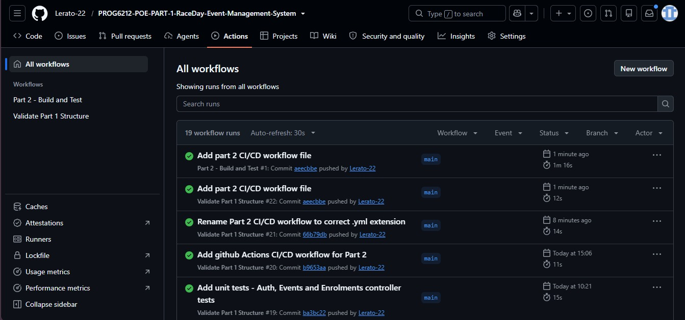

# PROG6212-POE-PART-1-RaceDay-Event-Management-System
# RaceDay - Event Management System

**Module:** PROG6212 - Programming 2B  
**Student:** Lerato Maropola 
**Student Number:** ST10449273
**Part:** 1 - System Planning and Database  
**Total Marks:** 100
**GitHub:** [PROG6212-POE-PART-1-RaceDay-Event-Management-System](https://github.com/Lerato-22/PROG6212-POE-PART-1-RaceDay-Event-Management-System)

## System Description

RaceDay is a full-stack web-based event management system built for the South African road running, walking, and cycling community. The platform allows Organisers to create and manage events, categories, and participant results, while Participants can browse upcoming events, enrol, track their personal performance history, and prepare for race day.

This is Part 1 of the Portfolio of Evidence which covers the full system planning phase — including the Entity Relationship Diagram, the API Endpoint Plan, and the SQL Database Script. No application code is written in this part.

## User Roles

- **Organiser** — can create, edit, and delete events, manage event categories, capture participant results, and view all event enrolments.
- **Participant** — can create an account, browse events, enter an event by selecting a category, view their own enrolments, and track their personal results.

## Part 1 Planning Documents

All planning documents are located in the `/docs` folder:

| File | Description |
|---|---|
| `ERD.drawio.png` | Entity Relationship Diagram showing all 6 entities, attributes, primary keys, foreign keys, and cardinality |
| `RaceDay-API-EndPoint-Plan..pdf` | Full API Endpoint Plan covering all 6 resource groups with HTTP method, route, role, request body, and response codes |
| `raceday_database.sql` | SQL Database Script that creates the full schema and seeds realistic sample data |


## How To Run The SQL Script

1. Open **SQL Server Management Studio (SSMS)**
2. Open the file `docs/raceday_database.sql`
3. Highlight the `CREATE DATABASE RaceDay;` line and press **F5**
4. Highlight the `USE RaceDay;` line and press **F5**
5. Select everything from the `DROP TABLE` lines to the bottom and press **F5**
6. Verify the output — you should see **Commands completed successfully** and a total count table showing all 6 tables with data

## CI/CD Screenshot

The GitHub Actions workflow validates that the `/docs` folder exists and contains all required planning files on every push to main.


## Video Presentation

[Part 1 Video Walkthrough - YouTube](https://youtu.be/xVeU20NCDJQ?si=uLa_1UwnLc8HajmA)

## Repository Structure

```
PROG6212-POE-PART-1-RaceDay-Event-Management-System/
│
├── .github/
│   └── workflows/
│       └── validate.yml
│
├── docs/

## Role Based Access
- Organiser endpoints are completely inaccessible to Participants
- Participant endpoints are completely inaccessible to Organisers
- Public endpoints such as viewing events are accessible to everyone
- Authentication is session based and enforced at the API level in Part 2
│   ├── ERD.drawio.png
│   ├── RaceDay-API-EndPoint-Plan..pdf

## Tech Stack
- **Database:** SQL Server (SSMS)
- **API:** ASP.NET Core Web API in C# (Part 2)
- **Frontend:** ASP.NET Core MVC (Part 3)
- **Cloud Storage:** Azure Blob Storage (Part 3)

## Submission
This repository is submitted via ARC for PROG6212 Part 1.
All planning documents are located in the /docs folder.

---

## Part 2 - RESTful API Development

**Module:** PROG6212 - Programming 2B
**Student:** Lerato Maropola **Student Number:** ST10449273 **Part:** 2 - RESTful API Development
**Total Marks:** 100 **GitHub:** [PROG6212-POE-PART-1-RaceDay-Event-Management-System](https://github.com/Lerato-22/PROG6212-POE-PART-1-RaceDay-Event-Management-System)

### System Description

RaceDay is a full-stack web-based event management system built for the South African road running, walking, and cycling community. The platform allows Organisers to create and manage events, categories, and participant results, while Participants can browse upcoming events, enrol, track their personal performance history, and prepare for race day.

This is Part 2 of the Portfolio of Evidence which covers the RESTful API development phase — including authentication, role-based access control, all CRUD endpoints, Swagger integration, unit testing, and GitHub Actions CI/CD. No MVC front end is built in this part.

### User Roles
- **Organiser** - Can create, edit, and delete events, manage categories, view all enrolments, and capture participant results.
- **Participant** - Can register an account, browse events, enrol into events by selecting a category, and view their personal results.

### Role Based Access
- Organiser endpoints are completely inaccessible to Participants
- Participant endpoints are completely inaccessible to Organisers
- Public endpoints such as viewing events are accessible to everyone
- Authentication is session based and enforced at the API level

### Setup and Run Instructions
1. Open **Visual Studio 2022**
2. Open the solution file at `Part2/RaceDay/RaceDay.slnx`
3. Update the connection string in `Part2/RaceDay/RaceDay/appsettings.json` to match your local SQL Server instance
4. Open the **Package Manager Console** and run:
5. Press **F5** to run the API
6. Navigate to `https://localhost:{port}/swagger` to view and test all endpoints

### API Endpoint Table

| HTTP Method | Route | Description | Role |
|---|---|---|---|
| POST | /api/auth/register | Register a new user | Public |
| POST | /api/auth/login | Login and create session | Public |
| POST | /api/auth/logout | Logout and clear session | Any |
| GET | /api/profile | View own profile | Any |
| PUT | /api/profile | Update own profile | Any |
| GET | /api/events | View all events | Public |
| GET | /api/events/{id} | View single event | Public |
| GET | /api/events/my | View organiser own events | Organiser |
| POST | /api/events | Create a new event | Organiser |
| PUT | /api/events/{id} | Update an event | Organiser |
| DELETE | /api/events/{id} | Delete an event | Organiser |
| GET | /api/events/{eventId}/categories | View categories for an event | Public |
| POST | /api/events/{eventId}/categories | Add a category to an event | Organiser |
| PUT | /api/events/{eventId}/categories/{id} | Update a category | Organiser |
| DELETE | /api/events/{eventId}/categories/{id} | Delete a category | Organiser |
| POST | /api/enrolments | Enrol into an event | Participant |
| GET | /api/enrolments/my | View own enrolments | Participant |
| GET | /api/events/{eventId}/enrolments | View all enrolments for an event | Organiser |
| PUT | /api/enrolments/{id}/status | Update enrolment status | Organiser |
| DELETE | /api/enrolments/{id} | Cancel an enrolment | Participant |
| POST | /api/results | Capture a participant result | Organiser |
| PUT | /api/results/{id} | Update a result | Organiser |
| GET | /api/results/my | View own results | Participant |
| GET | /api/events/{eventId}/results | View all results for an event | Organiser |

### Tech Stack
- **Database:** SQL Server (SSMS) with Entity Framework Core Code First
- **API:** ASP.NET Core Web API in C#
- **Authentication:** BCrypt password hashing with session management
- **Testing:** xUnit unit tests with in-memory database
- **CI/CD:** GitHub Actions
- **Frontend:** ASP.NET Core MVC (Part 3)
- **Cloud Storage:** Azure Blob Storage (Part 3)

### CI/CD Screenshot




### Video Presentation

[Part 2 Video Walkthrough - YouTube]
https://youtu.be/kzZiEKb7YCk?si=yKKlxHPpG5vPNFaH

### Submission
This repository is submitted via ARC for PROG6212 Part 2.
All API source code is located in the Part2/RaceDay folder.

### Repository Structure
PROG6212-POE-PART-1-RaceDay-Event-Management-System/
|
|-- .github/
| └── workflows/
| |── validate.yml
| └── part2-ci.yml
|
|-- docs/
| |── ERD.drawio.png
| |── RaceDay-API-EndPoint-Plan.pdf
| └── RaceDay-SQL-Script.sql
|
└── Part2/
└── RaceDay/
|── RaceDay/
| |── Controllers/
| |── Models/
| |── DTOs/
| |── Data/
| |── Migrations/
| └── appsettings.json
└── RaceDay.Tests/
|── AuthControllerTests.cs
|── EventsControllerTests.cs
|── EnrolmentsControllerTests.cs
└── TestSession.cs
